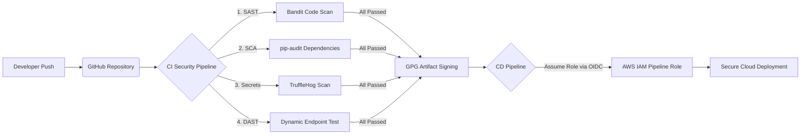

# Trainee Registration API - Secure Cloud & DevOps Capstone

This repository contains the source code, CI/CD pipelines, and security documentation for the **Trainee Registration API** project.

---

## Week 1 Deliverables: Secure SDLC & CI/CD Security

### 1. Secure Pipeline Architecture
*(معمارية مسار العمل الآمن - تظهر كرسم تخطيطي على GitHub)*

---

### 2. Threat Model (STRIDE Framework)
نموذج التهديدات الأمنية لمنصة تسجيل المتدربين (التي تتعامل مع بيانات شخصية PII مثل الاسم والإيميل):

| Threat Category (نوع التهديد) | Risk Scenario (سيناريو الخطر) | Mitigation Control (إجراء الحماية المطبق) |
| :--- | :--- | :--- |
| **Spoofing (انتحال الشخصية)** | محاولة رفع كود خبيث أو التلاعب بمخرجات البناء (Artifacts). | تطبيق **Artifact Signing (GPG)** للتأكد من هوية ومصدر الكود قبل نشره، واستخدام **AWS OIDC** للمصادقة. |
| **Tampering (التلاعب بالبيانات)** | إرسال بيانات غير صالحة أو محاولة حقن أكواد خبيثة (Injection) في حقول التسجيل. | تطبيق **Input Validation** داخل كود الـ API للتحقق من وجود وصحة الحقول المطلوبة (`name`, `email`, `track`). |
| **Information Disclosure (تسريب المعلومات)** | تسريب معلومات عن السيرفر عند حدوث خطأ، أو تسريب مفاتيح AWS داخل الكود. | إغلاق وضع التصحيح (`debug=False`) كما اكتشفته أداة **Bandit**، وتشغيل **TruffleHog** لمنع تسريب الأسرار. |
| **Vulnerable Components (مكتبات مخترقة)** | استخدام إصدارات قديمة من مكتبة `Flask` أو `Werkzeug` تحتوي على ثغرات. | دمج أداة **pip-audit (SCA)** في الـ Pipeline لإيقاف البناء فوراً إذا وُجدت مكتبات غير محدثة. |
| **Elevation of Privilege (رفع الصلاحيات)** | حصول الـ Pipeline على صلاحيات كاملة (Admin) داخل حساب AWS. | تحديد صلاحيات القراءة فقط في GitHub (`contents: read`) وتخصيص **IAM Role** بأقل صلاحيات ممكنة (Least Privilege). |

---

### 3. Secure Coding Checklist
قائمة المعايير الأمنية التي تم الالتزام بها في كتابة الكود (`app.py`):
* [x] **No Hardcoded Secrets:** لا توجد أي كلمات مرور أو مفاتيح API مكتوبة داخل الكود المصدري.
* [x] **Production Configuration:** تم تعطيل وضع الـ Debug (`debug=False`) لمنع ظهور تفاصيل الأخطاء البرمجية للمستخدمين (CWE-94).
* [x] **Input Validation:** التحقق من جميع المدخلات القادمة في طلب الـ `POST /register` ورفض أي طلب ناقص بكود `400 Bad Request`.
* [x] **Dependency Pinning & Updating:** تحديد إصدارات المكتبات الآمنة فقط في `requirements.txt` (`Flask>=3.1.0`, `Werkzeug>=3.1.0`).
* [x] **Ignore Sensitive Files:** استخدام ملف `.gitignore` لمنع رفع ملفات البيئة المحلية (`.env`, `venv/`).

---

### 4. Secrets Management Plan
خطة إدارة وحماية البيانات السرية في المشروع عبر مراحله المختلفة:
1. **مرحلة التطوير (Development):** يُمنع كتابة أي أسرار في الكود، ويتم استخدام ملفات `.env` محلياً مع إدراجها في `.gitignore`.
2. **مرحلة الـ Pipeline (CI/CD):** 
   * فحص أي كود مرفوع تلقائياً بواسطة **TruffleHog** و **GitHub Secret Scanning**.
   * عدم تخزين مفاتيح AWS ثابتة (`AWS_ACCESS_KEY_ID`) داخل GitHub، واستبدالها بتقنية **OpenID Connect (OIDC)** لتوليد جلسات مؤقتة عبر IAM Roles.
3. **مرحلة التشغيل السحابي (Cloud Runtime - الأسابيع القادمة):** سيتم تخزين أي بيانات سرية للتطبيق داخل خدمة **AWS Secrets Manager** أو **AWS Systems Manager Parameter Store** وحقنها بأمان وقت التشغيل.

---

### 5. SAST / DAST / SCA Results
جميع نتائج الفحص الأمني (Bandit, pip-audit, TruffleHog, Dynamic Check) وتوقيع الملفات (GPG Signed Artifacts) موثقة وتعمل تلقائياً مع كل تحديث في تبويب **[GitHub Actions](../../actions)** الخاص بهذا المستودع.